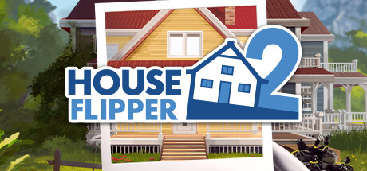

**House Flipper 2 by Empyrean and Frozen District (2023) is the sequel to the renovation simulator.**

---

## 📖 About

House Flipper 2 by Empyrean and Frozen District (2023) is the sequel to the renovation simulator. You buy derelict properties, clean, repair, redecorate, and resell for profit. The sequel deepens the market simulation and interior design tools but client requests become demanding later on.

## ⚠️ Problems Without Trainer

| Problem | Status |
|---------|--------|
| Client satisfaction requirements demand expensive material choices that cut profit | ✅ Solved |
| Cleaning efficiency too low without upgraded equipment bought with early savings | ✅ Solved |
| Property valuation drops from single style inconsistency in staging rooms | ✅ Solved |
| Negotiation skill needed to maximize sale prices requires many completed flips | ✅ Solved |
| Resource costs for premium renovations exceed initial budget on complex missions | ✅ Solved |

## ✅ Solution

The **House Flipper 2 Trainer** solves all these issues, giving you complete control so you can focus on enjoying the game.

## 🎯 Features

- Unlimited Resources / Currency
- God Mode / Invincibility
- Instant Skill & Ability Cooldown
- One-Hit Kill
- Freeze Timers
- Unlock All Items & Achievements
- Custom Speed Multiplier
- Infinite Stamina / Energy

## 🚀 Quick Start

1. **Disable Windows Defender** temporarily (trainer may trigger false positive)
2. Get the trainer from the button above
3. Launch House Flipper 2
4. Run the trainer as Administrator
5. Use the hotkeys to activate cheats in-game

## 💎 Free vs Pro

| Feature | Free | Pro |
|---------|------|-----|
| God Mode | ✅ | ✅ |
| Unlimited Resources | ✅ | ✅ |
| Advanced Cheats | ❌ | ✅ |
| Auto-Updates | ❌ | ✅ |
| Priority Support | ❌ | ✅ |

## 💻 Requirements

- Windows 10 / 11 (64-bit)
- House Flipper 2 (any version)
- .NET Framework 4.8+
- DirectX 11+

## 🍎 macOS

## ⚖️ Legal

Educational and single-player use only.

---

